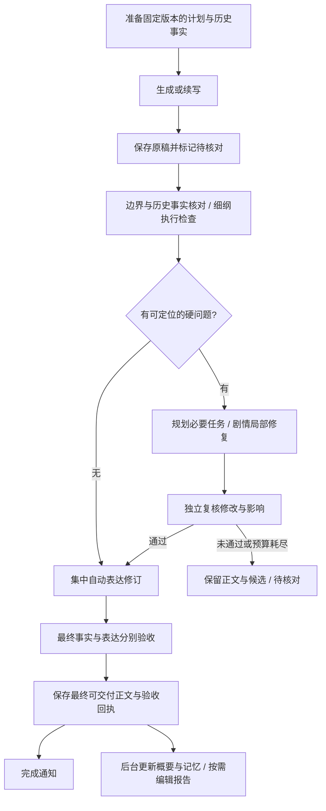

# Agent 职责与编排检查

检查日期：2026-11-03。基于当前工作区代码，包含尚未提交的通知设置与续写自动保存修改。

这里的 Agent 指应用里的模型任务角色，包括没有以 `agent` 命名的写作、审核、提取和修复任务。CLI/API 提供方是执行通道，文件仓库、算法质检和索引同步是程序组件，不应为了编排统一而改成模型 Agent。

本文保留最初源码审查的问题与建议，末尾补充本轮落地结果。证据行号对应优化前代码。实现和自动化回归没有调用付费模型，未测量真实项目耗时。

## 结论

优先调整续写、细纲核对、剧情修复、去 AI 味、记忆同步之间的交接。现有系统已经有原稿保存、版本校验、双重证据、候选稿、检查缓存和分类修复预算，不需要推倒重做。需要把这些机制收进同一个后端编排入口，让不同入口使用同一份任务契约和验收回执。

## 按优先级排列的问题

### P1：相同职责的路由不一致，部分任务没有显式路由

证据：`src/main/data/llm-service.ts:164` 的 `FEATURE_TO_CATEGORY`。

- 单章细纲检查 `outlineCheck` 路由到 `auxiliary`，批量检查 `batchOutline` 路由到 `opening`。两者都调用细纲对照逻辑，但可能使用不同模型与参数，影响结果一致性。
- `outlineLocalRepair` 会生成正文或细纲修改，却归入 `review`；精修的生成、方案、补救与核验全部归入 `refine`。职责角色与配置分类混在一起，无法单独选择精修审核模型。
- `memoryEvidenceRepair`、`foreshadowRepairReview`、`char-position-fix`、`adjust-plan-compliance`、`proseOutlineRewrite`、`downstreamOutlineSync` 没有显式映射，会回退到当前活动提供方。这是静态遍历 `feature` 字符串与路由表确认的六项；动态 feature 仍需在注册时校验。
- 长篇修复规划直接复用 `continuityRepairVerify`，统计和模型配置无法区分规划与验收。见 `longform-repair-planner.ts:44`。

建议：增加任务注册表，明确 `role`、模型配置分类、修改权限、验收要求和预算类别。兼容旧配置：核验模型未单独配置时继承现有路由；已有自定义配置迁移时保持可解释，不静默更换提供方。为六个缺失项补齐映射，并让单章与批量细纲检查采用一致策略。

### P1：一键同步的修复没有接入统一执行预算和取消链

证据：`write-service.ts:2103`、`outline-local-repair.ts:12`、`chapter-execution.ts:19`、`src/main/ipc/write.ts:588`。

- `autoRepairOutlineDifference` 没有创建 `runChapterExecution`，也不接收 `AbortSignal`；对应 IPC 没有请求取消生命周期。
- 局部修复在独立审核或复检失败时最多递归四次；生成调用为 `outlineLocalRepair`，也未列入分类修复预算。
- 前端检查章节是否已变，只能阻止后续采用，不能终止后端已经开始的模型调用。
- 已有续写预算为剧情纠错 12 次、表达修订 3 次，且不限制总调用数或总时长。模型层还有网络重试，业务层还有格式与修复重试，不能把一次业务尝试理解为一次网络请求。

建议：同步、续写、批量和补跑共享执行上下文；将局部修复接入内容修复预算，贯通取消信号。分别记录网络重试、格式重试、候选修复与最终复核。自动模式达到预算或不再改善时交出待处理结果；保留最终必要复核，不能以省调用为由把未验收当通过。

### P1：深度审稿的问题证据不够严格，却能进入自动剧情修复

证据：`review-flow-service.ts:230`、`:331`、`:364`，`write-service.ts:3817`、`:7491`。

深度审稿允许缺少 `snippet`；引文不在正文时 `locateFinding` 返回空位置，但问题仍被加入结果。`logic_hole`、`character_breakdown`、`quote_contradiction` 的 error 级结果可以成为自动衔接修复输入；`blockingContinuityIssue` 交接时又只拼接 `message`，没有把结构化引文和来源一起传下去。相比之下，`LongformGuard` 已要求本章与历史/计划的双重可定位证据。

建议：所有能触发剧情自动修改的问题，必须附本章引文、对照来源、问题类别、作用范围与版本。无法定位的结果记为“核验未完成/待复核”，阻止相关自动采用；不得直接据此改稿，也不得当成无问题。文风与爽感建议使用独立软性报告。

### P1：编排分散在前端、IPC 和大服务中，统一了子步骤但还没有统一交付流程

证据：单章入口 `src/main/ipc/write.ts:144`；批量后处理 `write-service.ts:3658`；一键同步 `ChapterFlowPanel.tsx:975`；后台同步 `write-service.ts:2533`。

单章使用“生成→写后细纲/伏笔修复→保存”，批量使用完整后处理流程，一键同步又在前端组织分析、误报裁决、局部修复、重跑与提交。关键护栏已有复用，但流程顺序、取消能力、缓存生命周期和返回结果仍不同。

建议：后端统一 `ChapterWorkflow`，入口只提交操作模式和版本，前端只展示进度与确认候选。操作模式明确为生成、续写、修复当前稿、同步当前稿和精修；同步模式不得隐式触发新章生成，精修模式不得自行补剧情。

### P2：剧情修复后可能再进入整章表达修订，检查结果会随稿件变化失效

证据：`write-service.ts:884` 先运行自动去 AI 味；单章 `:1273`、批量 `:3892` 的伏笔补写后又调用 `autoDeslopGeneratedProse`。

写作路径已经限制单轮场景表达修复为两次，并有停滞检测；但表达修订和剧情补写交错后，仍可能再次启动全章表达检查/修复。稿件变化会使细纲、事实、记忆提取结果失效，产生额外重跑。已有同稿缓存确实能省调用，不能把所有多次检查都判为重复。

建议：先完成事实纠错与必须事件补写，再集中运行一次自动表达修订。最终复核发现局部问题时只修相关范围并验证其影响；范围扩大或不收敛时保存候选，交给独立精修继续处理。稿件、证据或配置变化时必须使相关回执失效。

### P2：深度审稿按检查项串行，必需验收与编辑建议混在一起

证据：`review-flow-service.ts:206`、`:221`。启用全部内置语义项时有九类检查，每类还可能分块，执行顺序为检查项×文本块。自动深度审稿默认关闭，因此不能将它视为所有用户续写缓慢的固定原因。

建议：事实与边界属于交付前必需核对；风格、情绪、爽点等按题材与用户设置进入后台编辑报告。相互独立且读取同一不可变稿件的检查可受限并行。合并输出时必须分别保留每个检查的完成状态，防止用一个总分掩盖漏检。

### P2：概要、记忆和结尾状态有重叠提取，应共享证据而不是直接删除角色

证据：`write-service.ts:486` 的概要同时生成事件、状态和连续性台账；`write-flow-service.ts:255` 的记忆提取又提取事件、状态、道具、知情与伏笔；`:80` 单独提取结尾状态。

三者消费者不同，不能简单合并所有输出。现有结尾状态缓存、记忆分析缓存和概要复用应保留。风险主要是相同事实在不同提取结果中命名、状态或时点不一致。

建议：采用统一、带原文证据的事实快照作为共享输入；短概要、长期台账、实体更新和结尾承接分别作为投影。先共享快照与来源标识，再用真实样本判断哪些输出可由程序派生；不要一开始就要求模型返回更庞大的全能 JSON。

### P2：执行日志不足以解释耗时和验收失败

证据：`chapter-execution.ts:9` 只记录功能名、耗时与调用成功/失败/预算耗尽。一次模型调用正常结束并不表示候选通过验收；规划与审核还可能使用相同功能名。

建议：记录任务角色、阶段、输入/输出版本、缓存命中、模型路由标识、尝试类别及语义结果（通过/拒绝/未完成）。不保存密钥与敏感提示内容。将这些记录关联到用户已能看到的总耗时与每章耗时，再评估优化收益。

## 全部主要角色的职责安排

| 角色或角色组 | 当前涉及实现 | 建议安排 |
| --- | --- | --- |
| 选题、榜单分析、长短篇脑洞 | fanqie-chart、brainstorm、scan | 保持独立的立项阶段；产出建议与候选，不直接成为剧情事实。暂不优先重编排。 |
| 总纲、卷纲、节奏规划、细纲生成 | opening prompts、OutlineService | 只负责计划；生成与检查分开路由。自动补齐上下文时标明生成来源。 |
| 章名、书测标题、文风提取 | ChapterNameService、BookTestService、StyleProfileService | 按需执行；不进入每章交付必经链。 |
| 正文生成、续写 | WriteService.generateChapterStream | 只按固定任务与历史证据写作；保留只读前部、原稿保存和正文护栏。 |
| 按要求调整正文、修改方案 | planAdjustChapterStream、adjustChapterStream | 明确属于作者改稿操作；与保真精修分开，避免把润色理解为剧情变更授权。 |
| 主线、边界、知情与道具核对 | LongformGuard | 保留为必需事实守门角色；只检查，不改正文或计划，提供双重证据。 |
| 细纲执行检查 | WriteFlowService.checkOutlineStream | 负责必需事件、伏笔与完成度，不再兼任生成模型。与长期核对共享事实快照，保留各自检查结果。 |
| 误报裁决 | adjudicateOutlineDiffs | 保留窄权限；字数等程序可判事项直接计算，仅对有证据的允许项调用模型。 |
| 前文与细纲事实冲突处理 | reconcileOutlineWithHistory | 只纠正已发生事实的冲突；保持审计、历史重读和独立核验，不以错误正文倒改未来计划。 |
| 剧情修复规划 | planLongformRepairTasks | 只分组、排序、选择范围；单独任务标识，不承担验收或保存权限。 |
| 衔接/边界/细纲差异修复 | repairLongformConflict、repairContinuity、repairOutlineDifference | 共用问题格式和修复执行器；检查器决定问题，修复器生成候选，审核器决定是否通过，程序负责采用。 |
| 伏笔/必须事件补写 | repairMissingForeshadowings 及必需事件修复路径 | 只补当前阶段该发生的事件；放在表达修订前，不自行兑现后章节点。 |
| 自动去 AI 味与场景表达修订 | autoDeslopProse、DeslopService、repairDeslopScene | 自动模式集中修订一次、限制补救；事实和表达核验分开记结果。失败保存原稿与待修报告。 |
| 精修方案、候选、补救、核验 | ChapterRefinementService | 独立按需功能继续保留；复用自动表达检查的证据与候选，允许单独配置审核模型。朱雀人工复测与内部验收分开记录。 |
| 深度审稿 | ReviewFlowService | 有证据的事实问题进入修复；其余成为编辑建议。按需或后台执行，受限并行。 |
| 概要、结尾状态、记忆提取、证据修复 | summary、endingState、extractMemory、memoryEvidenceRepair | 共享事实快照；提取器只出候选，证据验证和程序写入层保留决定权。 |
| 节奏评估、图解、关系识别、人物识别、问答 | evaluateRhythm、generateFigure、detectCast/Relationships、answerChapterQuestion | 按需运行；与正文交付脱钩。识别结果是候选，问答不能直接改正文。批量已跳过无落地用途的节奏和图解，应保持。 |
| 拆文、封面提示词、封面学习与出图 | TeardownService、CoverPromptService、CoverLearningLibrary、CoverService | 保持独立任务域，接入统一进度与取消接口即可；不强行纳入章节写作 Agent 链。 |

## 建议的章节流程

表达修订失败时采用最后一份事实通过的正文并保留表达待修状态；事实核对失败或未完成时可以保存稿件，但继续隔离其概要/记忆，不向后章冒充已确认事实。只有已经完成前章必需事实准备，后章才继续读取。保存、事实验收、表达验收、记忆提交和人工复测是不同状态。

## 落地次序与验收

1. **先补可靠性缺口**：统一任务注册、缺失路由、局部修复预算与取消；自动改稿问题必须有证据。
2. **再统一后端流程**：迁移单章、批量、一键同步和补跑；共用输入快照、阶段回执与状态转换，保留已有版本冲突保护。
3. **调整顺序**：先剧情完整和边界，再自动表达修订，最后独立核验与保存；精修继续按需。
4. **最后按数据提速**：复用同版本证据、并行独立检查、减少重复提取，使用调用日志比较相同样本的耗时和质量。

必须覆盖：相同输入与配置下单章/批量验收一致；同步可取消且取消后不提交候选；缺失引文不能自动改稿；修改正文/计划/模型配置后旧回执失效；表达失败仍保存；事实失败不污染记忆；大范围修复仍保留作者审阅；未完成检查不能标成通过。性能需用相同项目样本和模型实测，不能仅以减少函数调用数宣称提速。

## 本轮落地结果

上述八类编排问题已落实到代码；独立业务角色按职责保留，不强行加入章节交付链。

| 审查项 | 已实现 | 主要位置 |
| --- | --- | --- |
| 任务职责与路由 | 注册角色、产出权限、验收要求和修订预算；补齐六项路由；单章/批量细纲核对统一；规划与核验分开标识；精修核验可独立配置并兼容旧配置 | `src/shared/agent-tasks.ts`、`llm-service.ts`、`FeatureRoutingForm.tsx` |
| 后端编排与取消 | 单章交稿、批量、同步、精修共用执行上下文；同步判断与修复循环移到后端；窗口关闭、切章和停止沿同一信号取消 | `chapter-workflow.ts`、`write-service.ts`、`ipc/chapter-request.ts`、`ChapterFlowPanel.tsx` |
| 证据约束 | 自动深审只保留必需事实检查；硬问题须有本章可定位原文及真实参考引文，否则记为核验未完成；编辑建议仍可按需查看 | `review-flow-service.ts`、`write-service.ts` |
| 修复收敛 | 局部候选补救最多两轮，连续性修复默认两轮；共享剧情 12 次/表达 3 次预算；增加 64 次调用/30 分钟停止追加修订阈值；同步连续三轮无改善停止 | `chapter-execution.ts`、`outline-local-repair.ts`、`continuity-repair.ts` |
| 写作顺序 | 单章与批量先完成剧情和伏笔修复并保存，再集中表达修订；后续事实修复不启动第二遍整章润色；最终细纲检查失败重新标记待核对 | `write-service.ts` 的 `deliverChapter`、`polishChapterDelivery`、`runFullFlow` |
| 事实共享与并行 | 原文版本与模型身份绑定的事实快照；概要共享真实引文定位，记忆和结尾状态分别缓存；独立深审最大并发 2，同步的概要和记忆并行，批量只在正文稳定后提取记忆 | `chapter-fact-snapshot.ts`、`write-flow-service.ts`、`review-flow-service.ts` |
| 精修衔接 | 接收同版本自动表达验收失败反馈；生成与核验分开路由；正文、上下文或模型路由改变后阻止采用旧候选；朱雀人工复测仍独立 | `chapter-refinement-service.ts` |
| 可观测性 | 日志区分模型调用成功与语义验收结果，记录角色、版本、缓存、耗时、路由指纹和重试；不记录模型正文、提示词及凭证 | `chapter-execution.ts`、`chapter-stage-cache.ts` |

事实快照中的引文只是定位辅助，不是新的事实来源；既有 Markdown、来源校验、版本冲突保护和候选采用检查继续生效。所有相关自动修订均有边界，实际语义正确性仍依赖模型与输入资料，不能保证零超纲或朱雀全绿。

回归覆盖任务路由、嵌套预算、并行事实快照、修复收敛、先剧情后表达、表达失败保存、事实隔离、同步取消与外部编辑冲突、精修模型变更、预加载通信及窗口关闭取消。验证结果随本次交付报告记录；耗时改善需要用同一小说、模型和参数另行实测。

最终验证：全量 Vitest 296 个测试文件通过、2 个跳过；4386 项测试通过、11 项跳过。Node/Web 类型检查、全局 ESLint、桌面构建和 Web 构建均通过。未调用真实付费模型，未执行 Windows 原生通知的桌面实机验证。
